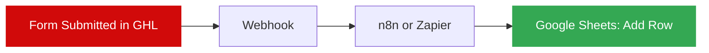
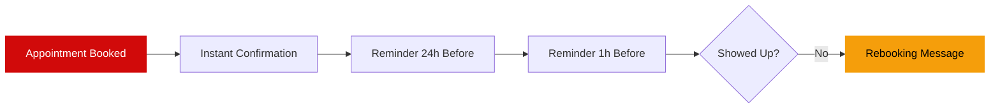
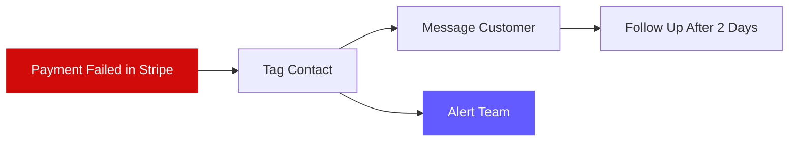

# GoHighLevel Automation Examples

**Ready-to-build automation blueprints for GoHighLevel. No client data. No API keys.**

Built by **Adnan Jameel** | GoHighLevel Expert | 2+ years hands-on experience

---

## 📋 What's Inside

| # | Automation | Tools | Level |
|:-:|---|---|:-:|
| 1 | 📥 [New Lead to Google Sheets](#1--new-lead-to-google-sheets) | GHL, Sheets, n8n or Zapier | 🟢 Easy |
| 2 | 📅 [Booking Confirmation and Reminders](#2--booking-confirmation-and-reminders) | GHL Workflows, SMS, Email | 🟡 Medium |
| 3 | 💳 [Failed Payment Alert](#3--failed-payment-alert) | GHL, Stripe, Slack or Email | 🟡 Medium |

---

## 1 📥 New Lead To Google Sheets

> [!NOTE]
> **Goal:** Every new lead from a GHL form is saved to a Google Sheet automatically, so your team sees all leads in one place.

**How the data flows:**

**Steps:**
1. In GHL, create a workflow with the trigger **Form Submitted**.
2. Add the action **Webhook** (or use the GHL app in Zapier or n8n).
3. In n8n or Zapier, receive the data and map: name, email, phone, source, date.
4. Add the action **Google Sheets: Add Row**.
5. Test with a dummy lead and check the new row.

<b>🛠️ Common problems and fixes</b>

- **Webhook returns an error:** check the URL and make sure the workflow is published.
- **Fields come through empty:** re-map the custom values.

---

## 2 📅 Booking Confirmation And Reminders

> [!NOTE]
> **Goal:** After someone books, they get an instant confirmation and reminders. This cuts no-shows.

**How the data flows:**

**Steps:**
1. Create a workflow with the trigger **Appointment Status: Confirmed**.
2. Send an instant SMS and email with the date, time, and a reschedule link.
3. Add a wait step and send a reminder 24 hours before.
4. Add another reminder 1 hour before.
5. If the status becomes **No Show**, send a rebooking message.
6. Test with a dummy booking.

<b>🛠️ Common problems and fixes</b>

- **Reminders send at the wrong time:** check the calendar and account time zone.
- **Duplicate messages:** make sure only one workflow uses this trigger.

---

## 3 💳 Failed Payment Alert

> [!NOTE]
> **Goal:** When a payment fails, your team and the customer are told right away, so revenue is not lost.

**How the data flows:**

**Steps:**
1. Create a workflow with the trigger **Payment Failed** (or a Stripe webhook).
2. Add the tag `payment-failed` to the contact.
3. Send the customer a friendly message with a link to update their card.
4. Notify the team by internal notification, Slack, or email.
5. Add a follow-up after 2 days if the tag is still there.

<b>🛠️ Common problems and fixes</b>

- **Trigger does not fire:** check the Stripe connection in GHL.
- **Customer gets the message after paying:** add a condition to check the payment status first.

---

> [!TIP]
> Want to check your whole account instead? See my [GHL Audit Checklist](https://github.com/adnanjameel-ghl/ghl-audit-checklist).

## 🚀 Need Something Built Or Fixed?

**I build GoHighLevel systems and fix broken ones.**

*Flexible hours with full overlap for US and UK time zones.*

